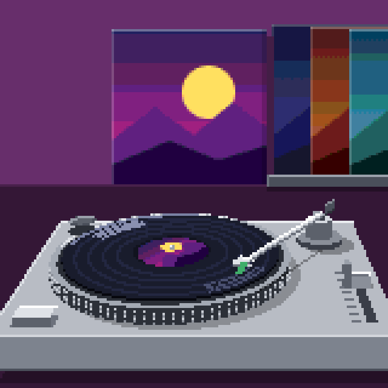
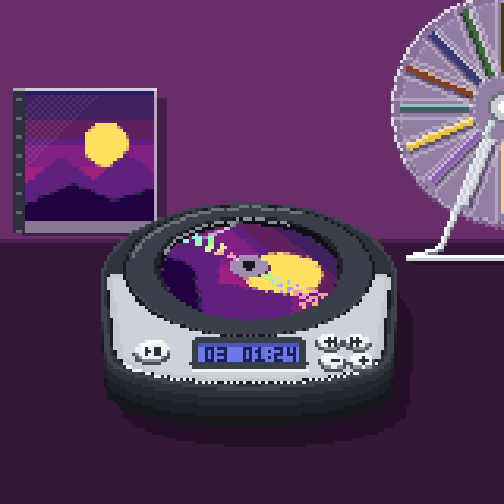
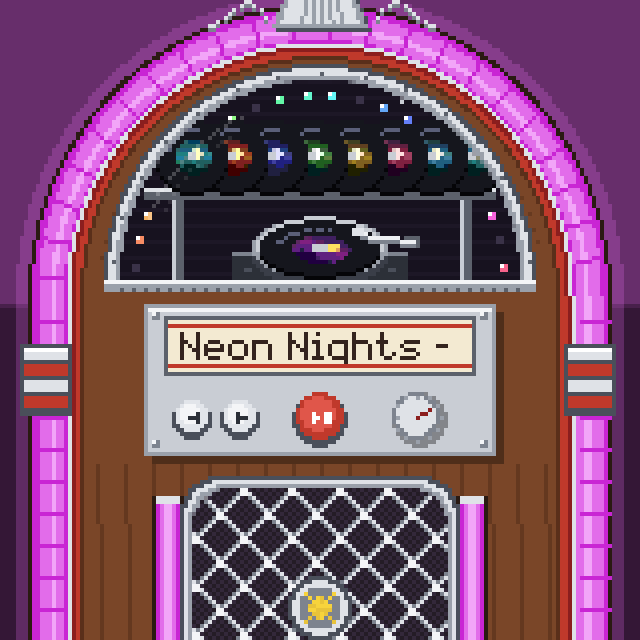
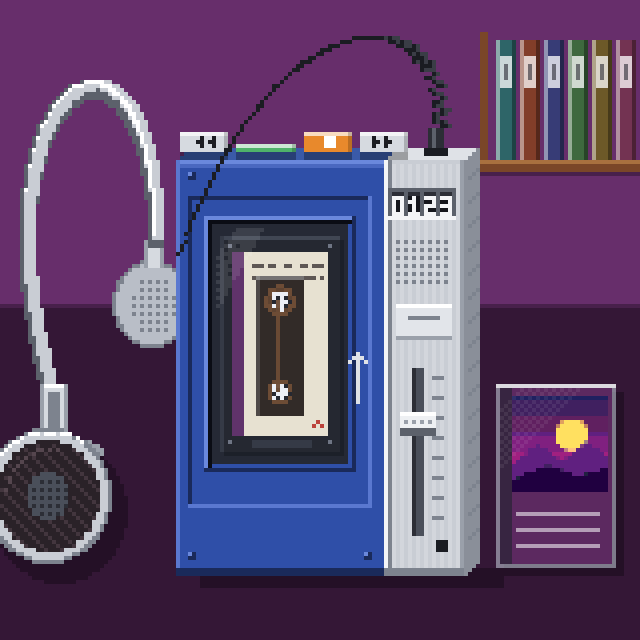

# notaplayer

A small pixel-art music player for your desktop. It shows the music you are playing on a pixel-art device, with the album cover on the disc. Pick the device in the menu under **Interface**:

| Vinyl | CD | Jukebox | Cassette |
| :---: | :---: | :---: | :---: |
|  |  |  |  |
| Turntable with the album's sleeve on the wall | Portable CD player with the jewel case and a wheel of your recent albums | Retro jukebox with a rack of 45s and a title card | Retro cassette player with headphones, the tape case and a wall rack of past albums |

## What it does

- **Follows your music**
  - macOS: Spotify.
  - Windows: anything in the Windows media panel (Spotify, browsers such as YouTube in Chrome or Edge, Apple Music, VLC and more).
- **Song name** (optional, vinyl and CD): turn on **Show song name** in the menu to see the title and artist in a pixel-font strip along the bottom. Long names scroll by. The jukebox shows it on its own title card.
- **No cover?** Songs without a cover (often from browsers) get a black placeholder with a music note.
- **Volume**: scroll up/down anywhere on the scene. It changes the music app's volume only, not the whole computer.
- **Three looks**: double-click an empty spot to cycle between them, or pick one from the menu.
  - **Window**: the full scene in a normal window.
  - **Scene widget**: the full scene, small, with rounded corners, sitting on the desktop.
  - **Disc widget**: just the spinning record, CD, 45 or cassette. On a change it flips like a coin.

  Widgets sit behind your other windows and can be dragged from any empty spot.
- **Menu**: right-click anywhere on the scene, or use the menu bar / tray icon. It switches looks and interfaces, turns the song name on or off, and quits the app. On MacBooks with a notch the menu bar icon can be hidden when the menu bar is full; right-click always works.

All settings (interface, look, song name, widget position) are remembered.

### Vinyl

- **Spinning record**: turns at 33⅓ RPM while playing and slows to a stop on pause. While paused, the tonearm lifts and hovers above the record.
- **Songs from the same album**: the record keeps playing; the tonearm just hops.
- **Album changes**: the record goes back into its sleeve, the sleeve slides into the stand on the right, and the new album slides out with its record. Going back to the previous album takes its sleeve back out of the stand. The wall takes on the color of the new cover.
- **Album stand**: the last 3 albums you played peek in from the right edge.
- **Controls**
  - Start/stop button (front left): play / pause.
  - Click the album on the wall: next song. Click the stand: previous song.
  - Volume slider on the right.
  - Grab the record and turn it: clockwise moves forward in the song, anticlockwise goes back (one full turn = 30 seconds). The music jumps there when you let go.

### CD

- **Spinning disc**: the cover is printed over the whole CD, which spins under a clear window in the lid.
- **LCD**: shows the track number and the running time; the time blinks while paused.
- **Songs from the same album**: the disc just keeps playing; only the LCD changes.
- **Album changes**: the lid opens, the disc goes into its case, the case flies into the wheel, the new album's case pops up, its disc drops in and the lid closes.
- **Album wheel**: a clear acrylic wheel holding your last 16 albums. Going back to the previous album takes its case back out of the wheel.
- **Controls**
  - ▶‖: play / pause.
  - ◀◀ / ▶▶: click for the previous / next song, hold to wind back / forward through the song.
  - − / +: volume.
  - Click the case on the desk: next song. Click the wheel: previous song.

### Jukebox

- **The dome**: a rack of small 45s with your recent songs (their covers on the labels), a gripper arm and a little turntable, with bulbs chasing around the back while it plays.
- **Every song gets its own record**: on each new song the gripper files the record into the rack and fetches the next one. Going back to the previous song runs it in reverse: the record goes back out and the previous one comes out of the rack.
- **Lights**: the tubes glow in the album's color and pulse while playing.
- **Title card**: always shows the song and artist, scrolling when it's long.
- **Controls**
  - Big red button: play / pause.
  - ◀ / ▶: previous / next song.
  - Volume knob: press on it and turn.

### Cassette

- **The tape**: a labelled tape sits behind the window with its reels turning; the tape moves from one reel to the other as the song plays.
- **Counter**: shows the song's running time.
- **Songs from the same album**: the tape fast-winds to the next song.
- **Album changes**: the door swings open, the tape goes into its case, the case goes up into the wall rack and the next album's case comes in. Going back to the previous album takes its case back out of the rack.
- **Controls**
  - ▶ (green): play. ■ (orange): pause.
  - ◀◀ / ▶▶: click for the previous / next song, hold to wind back / forward through the song.
  - Volume slider on the side.
  - Click the case: next song. Click the rack: previous song.

## Install

Download the file for your system from the [Releases](../../releases) page.

### macOS (Apple Silicon)

1. Open `notaplayer_<version>_aarch64.dmg` and drag **notaplayer** into **Applications**.
2. The app is not signed with an Apple developer account, so the first launch is blocked ("Apple could not verify…"). Click **Done**, then open **System Settings → Privacy & Security**, scroll down and click **Open Anyway** next to notaplayer. You only have to do this once.

   If macOS says notaplayer "is damaged" instead (version 0.0.0), run this once in Terminal and open it again:

   ```bash
   xattr -cr /Applications/notaplayer.app
   ```
3. When asked, allow notaplayer to control **Spotify**. If you clicked "Don't Allow", turn it on under **System Settings → Privacy & Security → Automation → notaplayer → Spotify**.

Intel Macs are not supported yet.

### Windows

1. Run `notaplayer_<version>_x64-setup.exe`.
2. The installer is not signed, so Windows may show "Windows protected your PC": click **More info** → **Run anyway**.
3. Start notaplayer from the Start menu and play some music.

Note: in Firefox the volume slider has no effect (Firefox doesn't tell Windows which program it is). Everything else works.

## Building it yourself

Needs [Rust](https://rustup.rs) and [Node.js](https://nodejs.org).

```bash
npm install
npm run tauri dev     # run while developing
npm run tauri build   # build the installer for your system
```

Pushing a tag like `v0.0.1` makes GitHub build the Windows `.exe` and the Mac `.dmg` and attach them to a release.

To change the app icon, replace `app-icon-macos.png` (1024×1024, in the macOS rounded-square shape) and run `npm run tauri icon app-icon-macos.png`.
